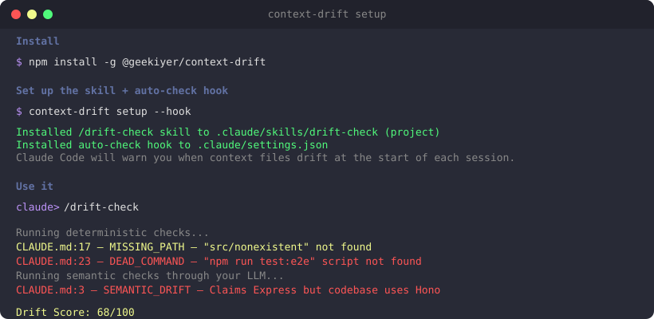
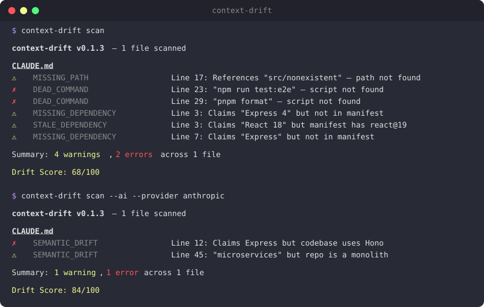

# context-drift

[](https://github.com/geekiyer/context-drift/actions/workflows/ci.yml)
[](https://www.npmjs.com/package/@geekiyer/context-drift)

Checks whether your AI context files (`CLAUDE.md`, `AGENTS.md`, `.cursorrules`, etc.) still match reality. Catches dead paths, stale dependencies, missing scripts, cross-file conflicts, and prose claims that no longer match the code.

## Quick start (Claude Code)

```bash
npm install -g @geekiyer/context-drift
context-drift setup --hook
```

Then in Claude Code, type `/drift-check`. That's it.

<p align="center">
  
</p>

### What `setup` does

`context-drift setup` installs a `/drift-check` skill into your project's `.claude/skills/` directory. When invoked, the skill:

1. Runs deterministic checks (paths, dependencies, commands, staleness, cross-file conflicts)
2. Builds semantic check prompts and processes them through Claude's own model
3. Reports everything it finds, grouped by file, with line numbers
4. Offers to fix the context files for you

The `--hook` flag adds an auto-check that warns you at the start of each Claude Code session when drift is detected. You can skip it if you prefer to run `/drift-check` manually.

### Setup options

```bash
# Project-level skill only (default)
context-drift setup

# Project-level skill + auto-check hook
context-drift setup --hook

# Global skill (available in all projects)
context-drift setup --global

# Global skill + hook
context-drift setup --global --hook
```

---

## Other ways to use it

### Standalone CLI scan

Run context-drift directly without Claude Code. Deterministic checks need no API key. Add `--ai` for LLM-powered semantic checks.

<p align="center">
  
</p>

```bash
# Deterministic checks only
context-drift scan

# With AI semantic checks
context-drift scan --ai

# JSON output for CI
context-drift scan --format json

# Strict mode (exit 1 on warnings)
context-drift scan --strict
```

### MCP server

For agents that speak MCP natively (Claude Code, Cursor, etc.):

```bash
claude mcp add context-drift context-drift-mcp
```

Exposes three tools:

| Tool | What it does |
|------|-------------|
| `check` | Runs the full scan (deterministic + semantic prompts) in one call |
| `prepare` | Returns LLM prompts for semantic checks |
| `commit` | Processes LLM responses into structured results |

### Prepare/commit CLI

For shell-based agent integration:

```bash
context-drift prepare . > requests.json
# agent processes each request's messages through its LLM
cat responses.json | context-drift commit
```

### Programmatic API

```typescript
import { scanPrepare, commitSemanticChecks } from "@geekiyer/context-drift";

const requests = scanPrepare("/path/to/repo");

const responses = await Promise.all(
  requests.map(async (req) => ({
    id: req.id,
    content: await myAgent.chat(req.messages),
  }))
);

const issues = commitSemanticChecks(responses);
```

The lower-level `prepareSemanticChecks(context)` and `scan(repoRoot)` are also exported.

---

## What it checks

### Deterministic (no API key)

- **Staleness** -- Days and commits since the file was last touched
- **Dependencies** -- "uses React 18" checked against `package.json`, `requirements.txt`, `pyproject.toml`, `go.mod`, `Cargo.toml`
- **Paths** -- `` `src/components/` `` or `` `lib/utils.ts` `` checked against the filesystem
- **Commands** -- `` `npm run test:e2e` `` or `` `make build` `` checked against scripts/Makefile
- **Cross-file conflicts** -- `CLAUDE.md` says `npm test`, `AGENTS.md` says `yarn test`

### Semantic (LLM-powered)

Catches what deterministic checks miss: prose descriptions that no longer match the code, outdated architectural claims, wrong API descriptions, stale convention descriptions. Uses the prepare/commit pattern so your agent handles the LLM call -- no separate API key needed.

### Drift score

0-100 score. Starts at 100, deducts for issues and staleness:

- Each error: -10
- Each warning: -3
- File older than 30 days: -1
- File older than 90 days: -3

## Supported context files

Scanned automatically if found at the repo root:

`CLAUDE.md`, `AGENTS.md`, `.cursorrules`, `.github/copilot-instructions.md`, `.windsurfrules`, `GEMINI.md`

Add more via `.context-drift.yml` config.

## Configuration

```yaml
# .context-drift.yml
files:
  - docs/AI_CONTEXT.md

staleness:
  warn_days: 30
  warn_commits: 50
  error_days: 90
  error_commits: 200

ignore:
  - code: STALE_DEPENDENCY
    file: CLAUDE.md
    line: 12
  - code: MISSING_PATH
    pattern: "docs/legacy/*"

strict: false
```

Generate a starter config: `context-drift init`

## CLI reference

```
context-drift setup [--global] [--hook]   Install skill and optional auto-check hook
context-drift scan [path]                 Scan repo for drift
context-drift scan --format json|github   Machine-readable output
context-drift scan --strict               Treat warnings as errors
context-drift scan --ai                   Enable AI semantic checks
context-drift scan --ai --provider X      Provider: anthropic, openai, ollama
context-drift scan --ai --model X         Model override
context-drift prepare [path]              Build LLM prompts (JSON to stdout)
context-drift commit                      Process LLM responses (JSON from stdin)
context-drift init                        Generate .context-drift.yml
context-drift version                     Print version
```

### Exit codes

| Code | Meaning |
|------|---------|
| `0`  | Clean |
| `1`  | Errors found |
| `2`  | Bad config or runtime failure |

## GitHub Action

```yaml
name: Context Drift Check
on: [pull_request]
jobs:
  check:
    runs-on: ubuntu-latest
    steps:
      - uses: actions/checkout@v4
        with:
          fetch-depth: 0
      - uses: context-drift/context-drift-action@v1
        with:
          strict: false
```

## Development

```bash
git clone https://github.com/geekiyer/context-drift.git
cd context-drift
pnpm install
pnpm build
pnpm test
```

### Project structure

```
src/
  cli.ts              CLI entry point (Commander)
  mcp.ts              MCP server (stdio transport)
  scanner.ts          Orchestrator: discover, parse, check, report
  config.ts           .context-drift.yml loader
  parsers/            Markdown + manifest parsers
  checkers/           Staleness, deps, paths, commands, cross-file, semantic
  ai/                 HTTP clients for Anthropic, OpenAI, Ollama
  reporters/          Console, JSON, GitHub annotations output
skills/
  drift-check/        Claude Code skill (shipped in npm package)
tests/
  fixtures/           Sample repos with intentionally drifted context files
```

### Tech stack

- TypeScript (ESM), built with tsup
- Commander for CLI
- MCP SDK for tool server
- unified/remark for markdown parsing
- simple-git for git operations
- Vitest for tests
- Biome for linting

## License

MIT
